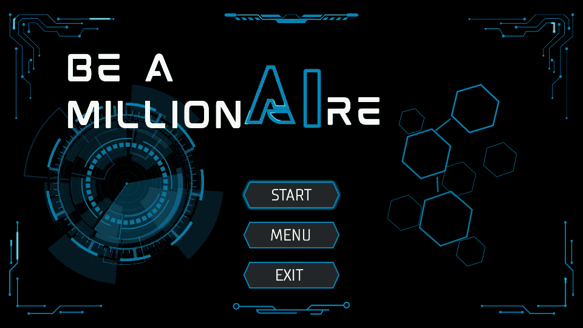

# Be a Millionaire

An offline quiz game about artificial intelligence, inspired by *Who Wants to Be a Millionaire?* Pick a category, put your AI knowledge to the test, and climb from **100 to 1,000,000 credits** through 15 questions.

**[Download for Windows](https://github.com/DarkShadsi/Be-A-MillionAIre/releases/download/dev-2026-10-17/BeAMillionaire-Setup.exe)** · [Release notes and checksums](https://github.com/DarkShadsi/Be-A-MillionAIre/releases/tag/dev-2026-10-17) · [Build from source](#build-from-source)



## Play on Windows

The **October 17, 2026 development build** supports **Windows 10 version 1903 or later and Windows 11, x64**. Java and the game libraries are included; installation and play work offline.

1. Download **BeAMillionaire-Setup.exe** using the link above.
2. Run setup and choose a dedicated installation folder. The default is `%LOCALAPPDATA%\Programs\BeAMillionaire`.
3. Finish setup and open the **Be a Millionaire** desktop shortcut.

Setup installs for your Windows account. Keep the installed game folder in place; the desktop shortcut points to it. After installation, you can remove the downloaded setup file.

This build includes the cyan AI game icon and the desktop shortcut icon fix. Re-running setup repairs the existing installation. To remove the game, use **Windows Settings → Apps → Installed apps → Be a Millionaire → Uninstall**.

> **Content status:** Three categories are playable, with 54 questions in total. Five more categories are listed in the game but still need questions. This is a development build.

## How to play

1. **Choose a playable category.** Each round draws five Easy, five Medium, and five Hard questions. Questions within each difficulty and their answer choices are shuffled.
2. **Select an answer, then lock it.** Each question has four choices and one correct answer. You can change your selection before choosing **Lock Answer**.
3. **Read the feedback and continue.** A correct answer earns that question's prize. Fifteen correct answers win **1,000,000 credits**.
4. **Choose when to walk away.** Before the first locked attempt on a question, **Walk Away** lets you bank your earned credits. It is unavailable during a Second Chance retry.

A wrong answer ends the round unless Second Chance grants a retry. The payout is the last checkpoint you secured, or zero before the first checkpoint. A checkpoint is secured by correctly answering its question.

| Checkpoint | Guaranteed credits |
| --- | ---: |
| Question 4 | 1,000 |
| Question 9 | 30,000 |
| Question 12 | 100,000 |

For example, answering Question 10 correctly and missing Question 11 pays **30,000 credits**, secured at Question 9.

### Three helps

| Help | What it does |
| --- | --- |
| **50:50** | Removes two incorrect choices, leaving one right and one wrong answer. |
| **Clue** | Reveals a hint. **View clue** reopens it on the same question. |
| **Second Chance** | Activate before locking to get one retry if your first answer is wrong. The first wrong choice is removed. |

Each help can be activated **once per round**, with **one help activation per question**. Second Chance is consumed on activation, even if your first answer is correct. During a retry, another help and Walk Away are unavailable. A second wrong answer ends the round. Reopening a clue does not consume another help.

<details>
<summary>View the full prize ladder</summary>

| Question | Credits | Milestone |
| --- | ---: | --- |
| 1 | 100 | |
| 2 | 300 | |
| 3 | 500 | |
| 4 | 1,000 | Checkpoint |
| 5 | 2,000 | |
| 6 | 5,000 | |
| 7 | 10,000 | |
| 8 | 15,000 | |
| 9 | 30,000 | Checkpoint |
| 10 | 50,000 | |
| 11 | 75,000 | |
| 12 | 100,000 | Checkpoint |
| 13 | 250,000 | |
| 14 | 500,000 | |
| 15 | 1,000,000 | Grand prize |

</details>

## Categories

The current question bank contains six questions per difficulty in each playable category. A round uses five from each difficulty.

| Category | Current availability |
| --- | --- |
| Artificial Intelligence Fundamentals | Playable — 18 questions |
| Knowledge and Problem Representation | Playable — 18 questions |
| Search and Game Playing | Playable — 18 questions |
| Machine Learning | Questions pending |
| Neural Networks | Questions pending |
| Deep Learning | Questions pending |
| Future of AI | Questions pending |
| Research in AI | Questions pending |

## Settings, controls, and history

Open **Menu** to switch between dark and light themes, toggle sound, reduce decorative motion, change fullscreen mode, view **Score History**, or read the five-page **Instructions** guide.

| Key | Action |
| --- | --- |
| **A–D** | Select an answer. |
| **Tab / Shift+Tab** | Move keyboard focus. |
| **Enter / Space** | Activate the focused button. Enter also locks or continues gameplay when no button has focus. |
| **F11** | Toggle fullscreen. |
| **Escape** | Close the active popup; otherwise leave fullscreen. |
| **Backspace** | Open the leave-round confirmation during gameplay, or return Home from other screens. |

Questions, choices, and answer feedback stay still while you read. Reduced motion makes decorative effects static. Sound and motion have separate controls.

Settings and scores are saved under `%LOCALAPPDATA%\BeAMillionaire`, with `.be-a-millionaire` in your home directory as a fallback. Reinstalling or uninstalling the Windows build preserves this saved data. **Total credits earned** in Menu sums completed-round payouts in Score History; leaving an unfinished round does not record a payout.

## Build from source

The source uses **Java 21**, **JavaFX 21**, and Maven. Install **JDK 21 or newer** and set `JAVA_HOME` or add the JDK's `bin` folder to `PATH`. The Maven wrapper is included. The first build needs internet access to download Maven and dependencies.

From PowerShell:

```powershell
git clone https://github.com/DarkShadsi/Be-A-MillionAIre.git
cd Be-A-MillionAIre
.\mvnw.cmd -B -ntp verify
java -cp "target/classes;target/lib/*" com.beamillionaire.Launcher
```

Run these commands from the repository root so the game can find `MCQ/questions.csv`. Keep `target/lib` alongside the compiled output.

For command-line question practice after building:

```powershell
java -cp "target/classes;target/lib/*" com.beamillionaire.Launcher --cli
```

To check the question pools and decode the required audio resources:

```powershell
java -cp "target/classes;target/lib/*" com.beamillionaire.tools.ReleaseCheck
```

The release check currently reports the five incomplete categories and exits with code 1; audio decoding passes. Maven `verify` compiles and packages this checkout. There are no Maven test sources in this revision, so build success alone does not verify gameplay.

The Windows download is a separately packaged development snapshot with installer and icon updates beyond this source revision. Its release notes identify the supplied build. Installer-building scripts are not included in this branch.

## Third-party notices

Distribution notices are in [THIRD_PARTY_NOTICES.md](THIRD_PARTY_NOTICES.md) and [third-party-licenses](third-party-licenses). Audio provenance is recorded in [SOURCES.json](src/main/resources/audio/SOURCES.json). Preserve these records, bundled dependency licenses, and font notices when redistributing the game.
