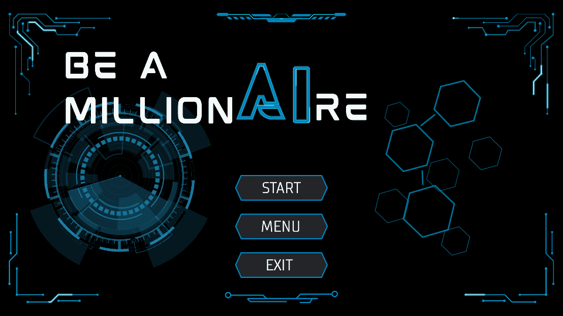

# Be a Millionaire

An offline Java 21 / JavaFX quiz game about artificial intelligence. Answer 15 questions, use three helps, and climb from 100 to 1,000,000 credits.



## Build and run on Windows

Install JDK 21 or newer, then set `JAVA_HOME` to its folder or put its `bin` folder on `PATH`. From the repository root:

```cmd
scripts\build-source.cmd
scripts\run-source.cmd
scripts\run-source.cmd --cli
```

In a Git checkout, the build script uses the Maven wrapper and runs `verify`. The first build needs internet access to download Maven and dependencies. In a prepared offline source folder containing `lib` and `sources.txt`, it compiles with `javac --release 21` into `out` and copies the resources. Keep the entire source folder together.

The scripts select Java from `JAVA_HOME` before `PATH` and add `javafx.controls` when the selected runtime bundles JavaFX. They forward launch arguments, including `--cli` and `--smoke-test`. PowerShell users can prefix commands with `.\`; for example, `.\mvnw.cmd -B -ntp verify`. The existing `cli.cmd` also starts question-bank practice mode. See [ReadMeFirst.txt](ReadMeFirst.txt) for checks and troubleshooting.

## Play a round

1. Choose a playable category. Each round selects five Easy, five Medium and five Hard questions, with shuffled question order within each difficulty and shuffled choices.
2. Read the stationary question and all four choices. Select A–D, change your selection if needed, then choose **Lock Answer**.
3. After a correct answer, read the feedback and choose **Continue**. After a win or loss, **View results** opens the outcome screen. A win uses the full-screen congratulations layout; a loss uses a centered Round Over panel.
4. **Walk Away** is available before the first locked attempt on the current question. Confirm to keep your earned credits and open the centered payout panel. It is unavailable during a Second Chance retry.

A terminal wrong answer pays the last secured checkpoint, or zero before Q4. Checkpoints are Q4: **1,000**, Q9: **30,000**, and Q12: **100,000** credits. Fifteen correct answers pay **1,000,000**. **Play Again** opens Categories; **Home** returns Home.

| Help | Effect |
| --- | --- |
| 50:50 | Removes two wrong choices. |
| Clue | Opens a hint; **View clue** reopens it on the same question. |
| Second Chance | Activated before locking, allows one retry after a wrong answer. The first wrong choice is removed. |

Each help can be activated once per round, and only one help can be activated per question. Second Chance is consumed on activation even if the first answer is correct. A retry permits neither another help nor Walk Away; a second wrong answer ends the round. Reopening a revealed clue is not another activation.

## Menu, controls and saved history

**Menu** provides theme, sound, reduced-motion and fullscreen settings, **Score History**, and a five-page **Instructions** guide: Categories, Questions, Helps, Ladder and Winning. Next/Previous navigate the guide; Done on its final page and Home return Home. Reopening the guide starts at Categories. Its illustrations do not start rounds or save scores.

The Menu's **Total credits earned** sums completed-round payouts saved in history. It refreshes when Menu opens; an empty history shows zero and an unreadable history shows Unavailable. Settings and score history are stored under `%LOCALAPPDATA%\BeAMillionaire`, with a home-directory fallback. A damaged history file is reported and preserved.

| Key | Action |
| --- | --- |
| A–D | Select an answer during gameplay. |
| Tab / Shift+Tab | Move keyboard focus. |
| Enter / Space | Activate the focused button. Enter also locks or continues gameplay when no button has focus. |
| F11 | Toggle fullscreen. |
| Escape | Close the active popup first; otherwise leave fullscreen. |
| Backspace | Open the leave-round confirmation in gameplay; return Home from other screens. |

Question text, choices, answer feedback and Instructions do not scroll. Score History has a scrolling list. Reduced motion makes decorative effects static. Sound and visual motion have separate controls.

## Current content and release checks

`MCQ/questions.csv` contains **54 questions**: six per difficulty in each of three playable categories—Artificial Intelligence Fundamentals, Knowledge and Problem Representation, and Search and Game Playing. The other five categories still need questions. See [MCQ/README.md](MCQ/README.md) for the format and counts.

All nine WAV files required by `GameAudio.FILES` are present. See [audio/README.txt](src/main/resources/audio/README.txt) for playback and provenance limitations. After a Maven build, run:

```cmd
java -cp "target/classes;target/lib/*" com.beamillionaire.tools.ReleaseCheck
```

This checks CSV completeness and decodes audio without a graphics display or audio device. It currently reports the five incomplete categories. Maven `verify` compiles and packages this checkout; there are no Maven test sources, so a successful build is not a gameplay regression test.

Build 20 source/executable packaging is planned; its packaging script and standalone distribution are not part of this checkout. The Maven JAR requires its dependencies and an explicit classpath launch. Architecture and motion notes are in [docs/ARCHITECTURE.md](docs/ARCHITECTURE.md) and [docs/CONTINUOUS_MOTION.md](docs/CONTINUOUS_MOTION.md).

## Notices

Preserve [THIRD_PARTY_NOTICES.md](THIRD_PARTY_NOTICES.md), dependency notices, font notices and audio source records when distributing the game. See the audio README for the current source-record gaps.
